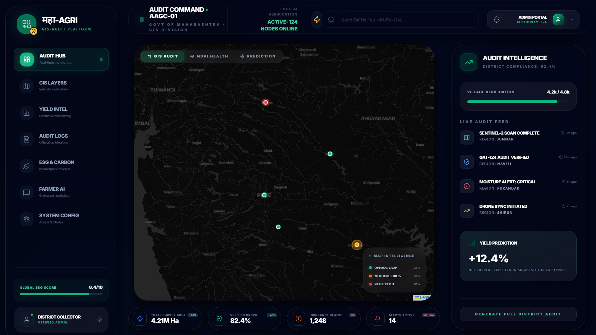
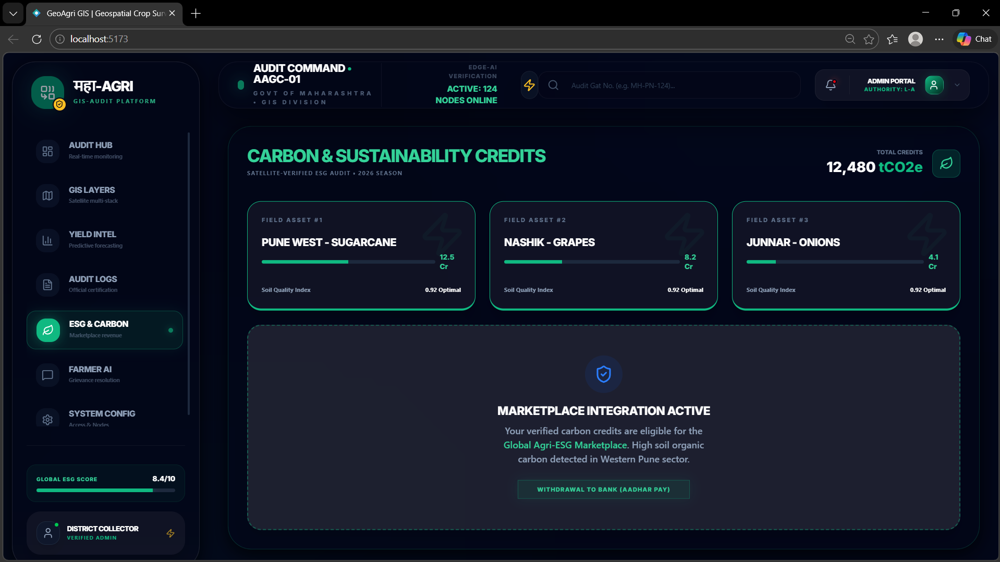
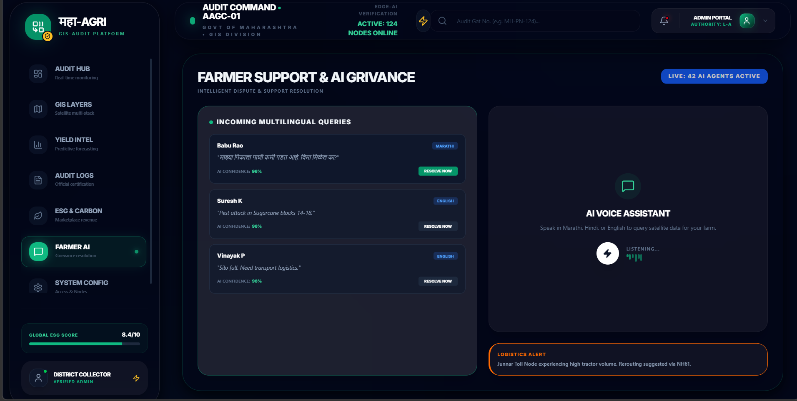

# 🌾 Geospatial & GIS-Based Crop Survey System
### *GIA — Geo-Spatial Intelligent Audit Platform*

<div align="center">


> **Digitizing Maharashtra's Fields: Accurate, Real-Time Spatial Intelligence for a Sustained Future.**

[🚀 Live Demo](#) • [📋 Features](#-features) • [🛠 Tech Stack](#-tech-stack) • [📸 Screenshots](#-screenshots) • [⚙️ Setup](#️-setup--installation)

</div>

---

## 📖 Project Overview

**GIA (Geo-Spatial Intelligent Audit)** is an integrated, multi-modal geospatial platform built for the **Pune International Agri Hackathon 2026**. It addresses one of India's most critical challenges — the lack of real-time, accurate crop survey data for Maharashtra's 14+ million hectares of farmland.

Traditional crop surveys are:
- 📅 **3–6 months delayed** (manual fieldwork lag)
- ❌ **Error-prone** (human reporting inaccuracies)
- 💸 **Fraud-vulnerable** (subsidy & insurance misuse)
- 🗺️ **Not spatially verifiable** (no GIS-linked 7/12 records)

GIA solves all of this with a **satellite + drone + AI + GIS** pipeline.

---

## ✨ Features

### 🗺️ GIS Crop Mapping Dashboard
- Interactive **React-Leaflet** map of Maharashtra
- Real-time crop markers with health overlays (NDVI/EVI)
- Field selection → Gat-number level drill-down
- Animated map clustering for high-density districts

### 📊 Analytics & Intelligence Panel
- **Yield Forecasting** with historical trend charts (Recharts)
- Crop distribution breakdown (Sugarcane, Grapes, Onion, Pomegranate)
- NDVI health score visualization per field
- Month-over-month rainfall vs yield correlation

### 🛰️ Satellite & Sensor Integration
- **Sentinel-2 (Optical)** — Multispectral crop classification
- **Sentinel-1 (SAR Radar)** — Cloud-penetrating monsoon monitoring
- Automatic NDVI / EVI index computation
- Drought score updates per district pocket

### 📱 Field Survey Module
- Geo-tagged, timestamped field photo ledger
- Mobile agent verification with Edge AI crop classification
- Offline-first syncing when connectivity is restored
- Tamper-proof audit trail per Gat number

### 📄 Official GIS Audit Certificate Generator
- One-click printable PDF report per crop field
- Area verification (satellite double-validated via SAR)
- Health certification with NDVI score
- Yield forecast with carbon credit balance

### 🌱 Sustainability Dashboard
- Soil Organic Carbon tracking
- Water Usage Efficiency metrics
- Carbon Credits generated per field
- Environmental KPIs aligned with national agri policy

### 🆘 Grievance & Support Module
- Farmer grievance submission portal
- District-level case tracking
- Alert system for anomaly detection (drought, pest, flood)

---

## 🛠 Tech Stack

| Layer | Technology | Purpose |
|---|---|---|
| **Frontend** | React 19 + TypeScript | UI Components & State |
| **Styling** | Tailwind CSS v4 | Responsive Design |
| **Maps** | React-Leaflet + Leaflet.js | Interactive GIS Maps |
| **Charts** | Recharts | Data Visualization |
| **Animations** | Framer Motion | UI Transitions |
| **Icons** | Lucide React | Icon System |
| **Build Tool** | Vite 8 | Fast Dev & Build |
| **Linting** | ESLint + TypeScript ESLint | Code Quality |
| **GIS Backend** | PostGIS (planned) | Spatial Database |
| **Map Server** | GeoServer (planned) | WMS/WFS Tile Serving |
| **AI/ML** | TensorFlow Lite (planned) | Edge Crop Classification |
| **Satellite** | Sentinel-1 & Sentinel-2 (planned) | SAR + Optical Imagery |

---

## 📁 Project Structure

```
geospatial-crop-survey-system/
├── public/
│   ├── favicon.svg
│   └── icons.svg
├── src/
│   ├── assets/
│   │   └── hero.png
│   ├── components/
│   │   ├── MapUI.tsx          # Interactive Leaflet Map
│   │   ├── Sidebar.tsx        # Navigation & Field List
│   │   └── AnalyticsPanel.tsx # Charts & Stats Panel
│   ├── lib/
│   │   └── mockData.ts        # Crop, Survey & Stats Data
│   ├── App.tsx                # Root App Component
│   ├── main.tsx               # Entry Point
│   └── index.css              # Global Styles
├── index.html
├── package.json
├── tailwind.config.js
├── vite.config.ts
├── tsconfig.json
└── README.md
```

---

## 🗺️ Coverage Area (Maharashtra Districts)

| District | Crops Monitored | Area (Ha) | Status |
|---|---|---|---|
| Pune (Haveli) | Sugarcane | 124 | 🟢 Optimal |
| Nashik (Niphad) | Grapes | 54 | ✅ Ready |
| Pune (Junnar) | Onions | 210 | 🔴 Stressed |
| Pune (Shirur) | Pomegranate | 95 | 🟢 Optimal |
| Solapur | Grapes | 320 | ✅ Harvested |
| Pune (Purandar) | Custard Apple | 85 | 🟢 Optimal |
| Pune (Baramati) | Sugarcane | 410 | ✅ Ready |

---

## ⚙️ Setup & Installation

### Prerequisites
- **Node.js** v18+ 
- **npm** or **pnpm**

### Steps

```bash
# 1. Clone the repository
git clone https://github.com/ASHUTOSHNIMBALKAR/geospatial-crop-survey-system.git
cd geospatial-crop-survey-system

# 2. Install dependencies
npm install

# 3. Start development server
npm run dev

# 4. Open in browser
# → http://localhost:5173
```

### Build for Production

```bash
npm run build
npm run preview
```

---

## 🔬 Methodology

```
┌─────────────────────────────────────────────────────────────────┐
│                     GIA Data Pipeline                           │
├─────────────┬──────────────┬────────────────┬───────────────────┤
│  MACRO SCAN │ MICRO AUDIT  │ GROUND TRUTH   │   GIS SYNTHESIS   │
│             │              │                │                   │
│ Sentinel-2  │ Drone Survey │ Mobile Agent   │ PostGIS Database  │
│ Sentinel-1  │ Photogramm-  │ Geo-Tagged     │ GeoServer WMS     │
│ SAR Radar   │ etry 5cm res │ Photos         │ React-Leaflet UI  │
│             │              │ Edge AI (TFL)  │                   │
└─────────────┴──────────────┴────────────────┴───────────────────┘
```

1. **Macro-Level Scanning** — Sentinel-2 (optical) + Sentinel-1 (SAR) for broad crop classification
2. **Precision Drone Auditing** — cm-level resolution for Sugarcane, Grapes, Pomegranate
3. **Ground Truth Verification** — Field agents with offline Edge AI identification
4. **GIS Synthesis** — All layers merged in PostGIS at Gat-number resolution

---

## 🤖 AI & ML Components

| Model | Use Case | Framework |
|---|---|---|
| Random Forest | Multi-temporal crop classification | Scikit-learn |
| CNN | Crop health & pest detection from images | TensorFlow Lite |
| NDVI Index | Vegetation health scoring | Spectral Analysis |
| EVI Index | Enhanced vegetation for dense canopy | Spectral Analysis |

---

## 🌐 Scalability Roadmap

- [x] **Phase 1**: Pune District Pilot (7 talukas, web dashboard)
- [ ] **Phase 2**: Nashik + Solapur + Aurangabad rollout
- [ ] **Phase 3**: Full Maharashtra state-wide deployment
- [ ] **Phase 4**: Integration with MahaBhumi / 7-12 records
- [ ] **Phase 5**: National expansion + Private insurance APIs

---

## 💼 Business Impact

| Stakeholder | Benefit |
|---|---|
| **Government** | Real-time crop census, accurate subsidy allocation |
| **Farmers** | Faster insurance payouts, data-driven advisory |
| **Insurance Companies** | Fraud prevention, verified claim evidence |
| **Agro-industries** | Market supply-chain forecasting |
| **Banks** | Accurate agri-credit risk assessment |

> 💡 **Potential Savings**: Reducing insurance fraud alone can save ₹1,000+ crore annually across Maharashtra.

---

## 📸 Screenshots

| Dashboard | GIS Map | Analytics |
|---|---|---|
|  |  |  |

---

## 🏆 Hackathon Details

| Field | Info |
|---|---|
| **Event** | Pune International Agri Hackathon 2026 |
| **Theme** | Geospatial & GIS-Based Crop Survey System |
| **Track** | AgriTech / GovTech / Precision Agriculture |
| **Focus Area** | Maharashtra Crop Monitoring & Transparency |

---

## 🤝 Contributing

Pull requests are welcome! For major changes, please open an issue first to discuss what you would like to change.

```bash
# Fork → Clone → Branch → Commit → PR
git checkout -b feature/your-feature-name
git commit -m "feat: add your feature"
git push origin feature/your-feature-name
```

---

## 📄 License

This project is licensed under the **MIT License** — see the [LICENSE](LICENSE) file for details.

---

## 👥 Team

Built with ❤️ for Maharashtra's farmers at the **Pune International Agri Hackathon 2026**

> *"Data-driven agriculture is not the future — it's the present Maharashtra needs."*

---

<div align="center">

**⭐ Star this repo if you found it useful!**

[](https://github.com/ASHUTOSHNIMBALKAR/geospatial-crop-survey-system)

</div>


